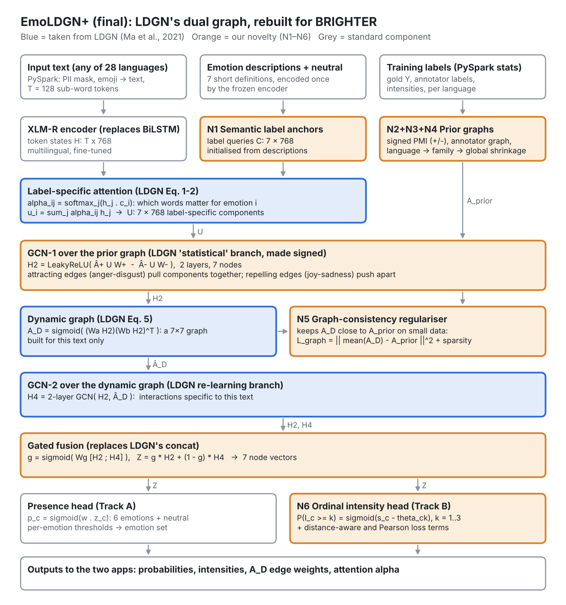
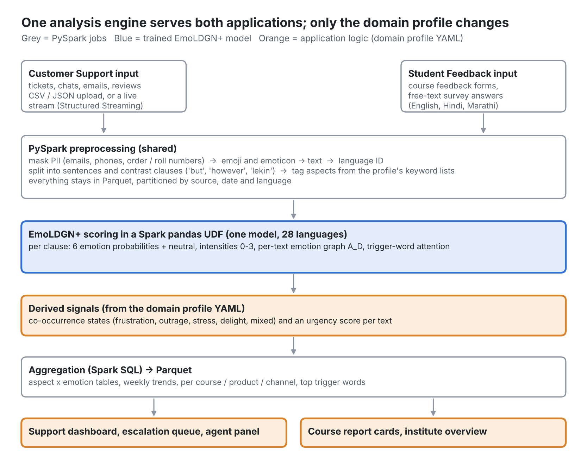

# 1. The final design at a glance

**Problem statement.** Detect which emotions a short text expresses (multi-label, SemEval-2025 Task 11 Track A on BRIGHTER) with a graph neural network that models how emotions co-occur. The same model also predicts intensity (Track B) and transfers to unseen languages (Track C). It powers two applications: **Customer Support Analysis** and **Student Feedback Analysis**.

**Base architecture.** LDGN, the Label-Specific Dual Graph Neural Network (Ma et al., ACL 2021), with an XLM-R encoder:

1. Each emotion attends to its own trigger words.
2. A GCN reasons over a co-occurrence graph built from the training data.
3. A second GCN reasons over a graph rebuilt for every single text.

Sections 2 and 3 explain it and verify that it fits BRIGHTER.

**What changed in this final version.** Ten papers you shared were checked (LDGN, EmoGraph, LiGCN, Lotus and six Track B and C system papers), plus the task README. The six Track B and C system papers were audited in section 4: what we already do, what we do not, and what is worth adding. Seven ideas from them were integrated in the previous version. This final version then cuts the plan to a compute budget of about 3 to 4.5 GPU-hours on an RTX 3050: it keeps the original LDGN architecture and only the additions that cost no extra training runs (section 6.6). The applications are the two you chose, and the emoji suggester is dropped.

## 1.1 Final component list

This version is sized for a **3 to 4.5 GPU-hour compute budget on a single RTX 3050 (6 GB)** (section 6.6). The original LDGN architecture is kept in full. Additions that add no training runs stay in the model; additions that need extra training stages, extra models or many extra experiments were removed or deferred.

| Tier | Component | Source | Where |
|---|---|---|---|
| **Core (unchanged LDGN)** | Label-specific attention, GCN over the statistical co-occurrence graph, per-text dynamic graph, second GCN, per-emotion scores; also the faithful baseline B4 | LDGN | 2, 5.1, 10.1 |
| **Must have (no extra runs)** | N1 Semantic label anchors | ours | 5.2 |
| Must have | N2 Signed co-occurrence graph with a neutral node | ours | 5.3 |
| Must have | N4 Hierarchical graph prior: language, then family, then global | ours + UoB-NLP (language families) | 5.5 |
| Must have | N5 Graph-consistency regulariser and gated fusion | ours | 5.6 |
| Must have | N6 Ordinal intensity head with distance-aware and Pearson loss terms | ours + tinaal | 5.7 |
| Must have | Training recipe: emoji-to-text normalisation, one stratified train/validation split by emotion and language, pooled per-emotion thresholds, capped epochs | UB_Tel-U | 6.5 |
| Must have | Track C: zero-shot prediction on the official test sets (inference only) | XLM-EMO, UoB-NLP | 10.4 |
| Must have | Both applications on one shared engine | ours | 9 |
| **Optional (only if the core finishes early)** | N3 Annotator-perception graph and soft labels | ours, confirmed by the README | 5.4 |
| **Removed to save time** | 5-fold cross-validation and the fold ensemble (weighted mean, OR rule); 3 seeds on every run; N7 LLM teacher and student (Lotus); N8 second attention round (LiGCN); span mixup (tinaal); encoder comparisons (Afro-XLMR, Twitter-XLM-R); baselines B3 and B5; leave-one-language-out; large ablation grid | — | 5.8, 6.6 |
| **Deferred** | Emoji graph (N9), language adapters, LLM zero-shot ensembles, external labelled corpora | — | 4.3 |

## 1.2 The two applications in one paragraph each

**Customer Support Analysis.** Tickets, chats and reviews are cleaned in PySpark (personal data masked), split into clauses, tagged with aspects (delivery, refund, product, staff and so on), and scored by EmoLDGN+. The dashboard shows an **urgency-ranked escalation queue** and derived states such as **frustration** (anger together with sadness, confirmed by the per-text graph) or **outrage** (anger with disgust). It also shows weekly trends per aspect and channel, and an agent panel with the trigger words and a suggested response tone.

**Student Feedback Analysis.** Course feedback in English, Hindi or Marathi (all three are BRIGHTER languages) gets the same pipeline. Each course gets a **report card**: emotion profile, share of mixed feedback, an aspect-by-emotion heatmap (teaching, content, exams, assignments, workload), representative comments with highlighted triggers, and semester comparisons. Example: "I enjoyed the course, but the examination was stressful and confusing" becomes joy on *course content* plus fear on *exams*. Reports appear only for groups of at least 10 comments, to protect anonymity.

Both applications run on one engine. Only a YAML "domain profile" (aspects, derived states, escalation rules) differs between them.

## 1.3 Honest limits

- BRIGHTER annotates six basic emotions in social-media, literary and news text. "Frustration" and "stress" are derived from co-occurring emotions. "Confusion" is not a BRIGHTER emotion and is handled as a keyword cue.
- Support tickets and course feedback differ from BRIGHTER's domains. The applications are therefore evaluated on small hand-labelled samples from each domain (section 9.6), not only on SemEval scores.
- BRIGHTER is licensed for research use only and must not be redistributed. The applications are academic prototypes, and commercial use would need separate permission.

# 2. The base paper, LDGN, in brief

LDGN has two modules: a label-specific document representation, and a dual GNN that learns interactions between the label-specific components. Notation follows the paper: $C$ labels, a document of $J$ words, hidden size $D$.

## 2.1 Label-specific document representation

A BiLSTM encodes the words into $h \in \mathbb{R}^{J \times D}$. Each label $i$ has a randomly initialised vector $c_i$. Label-guided attention pulls out the part of the document relevant to that label:

$$\alpha_{ij} = \frac{\exp\!\left(h_j c_i^{\top}\right)}{\sum_{j'} \exp\!\left(h_{j'} c_i^{\top}\right)}, \qquad u_i = \sum_{j} \alpha_{ij}\, h_j$$

$u_i \in \mathbb{R}^{D}$ is the "semantic component" of the document for label $i$. Stacking all labels gives $U \in \mathbb{R}^{C \times D}$. Unlike ML-GCN, where every label sees the same document vector, here every label sees its own view of the text.

## 2.2 Branch 1: interaction learning on the statistical co-occurrence graph

The adjacency $A^{s}_{ij}$ is the conditional probability that a sample has label $i$ given it has label $j$, computed on training data. A two-layer GCN propagates the components over this graph:

$$H^{l+1} = \sigma\!\left(\hat{A}^{s} H^{l} W^{l}\right), \qquad \hat{A} = D^{-\frac12} A\, D^{-\frac12}, \qquad H^{0} = U$$

with LeakyReLU as $\sigma$. The output after two layers is $H^{2}$.

## 2.3 Branch 2: re-learning on a dynamic reconstruction graph

The paper argues that global statistics are incomplete (pairs unseen in training), noisy (rare pairs), and not adaptive to individual documents. It therefore builds a new graph for each document from $H^{2}$ using two $1\times1$ convolutions and a dot product:

$$A^{D} = \mathrm{sigmoid}\!\left( (W_a * H^{2})^{\top} (W_b * H^{2}) \right)$$

$A^{D}$ is normalised as above, and another two-layer GCN produces $H^{4}$.

## 2.4 Prediction and loss

The two representations are concatenated, $H^{O} = [H^{2}; H^{4}]$, and a shared linear layer gives one sigmoid score per label: $\hat{y}_c = \sigma(W_1 H^{O}_c)$. Training uses binary cross-entropy. In the ablation, statistical-only (S) and dynamic-only (D) both beat no graph, D beats S, and S+D is best. Tail-label metrics (PSP@k) also improve over the LSAN baseline.

# 3. Verification against BRIGHTER: what fits, what must change

| Aspect | LDGN as published | BRIGHTER / SemEval-2025 Task 11 | Consequence for us |
|---|---|---|---|
| Problem type | Multi-label text classification | Multi-label emotion detection (Track A) | Same formulation; fits directly |
| Label graph | Conditional-probability co-occurrence graph | Emotions co-occur strongly (for example anger with disgust) | Fits the problem statement exactly |
| Number of labels | 54 to 3,954 | 5 or 6 emotions (English has no disgust) | Graph is tiny; every edge matters, and repulsion between emotions becomes informative (N2) |
| Label vectors | Random initialisation | Emotion names carry meaning, shared across languages | Use semantic anchors (N1) |
| Text length | 163 to 1,225 words on average | Single sentences and short posts | Label attention still works; T = 128 tokens suffices |
| Encoder | BiLSTM over skip-gram vectors | 28 languages, many low-resource | Replace with XLM-R (standard upgrade, not counted as novelty) |
| Training size | 11k to 55k documents | About 66k training rows in total, 900 to 3,700 per language | Dynamic graph can overfit, so regularise it (N5); train multilingually; shrink per-language graphs (N4) |
| Label source | Single gold label set | Gold label is an aggregate of several annotators; per-annotator labels are released | Build an annotator-perception graph and soft labels (N3) |
| "No label" case | Not modelled | Neutral texts have no emotion | Add a neutral node (N2) |
| Extra supervision | None | Intensity 0 to 3 for 11 languages (Track B) | Joint intensity head (N6), which also gives the applications an urgency and severity signal |
| Metric | P@k, nDCG@k, PSP@k | Average macro-F1 (Track A), Pearson r (Track B) | Report macro-F1 and tune per-emotion thresholds; ranking metrics are meaningless with 6 labels |
| Dataset | AAPD, EUR-Lex, RCV1 | BRIGHTER only | We use only the architecture, as required |

BRIGHTER sizes come from the [task paper](https://arxiv.org/html/2503.07269v2), Table 1. The English label set without disgust and the release of per-annotator labels are noted on the [task repository](https://github.com/emotion-analysis-project/SemEval2025-Task11) and the [BRIGHTER project page](https://brighter-dataset.github.io/).

**Honest risk.** LDGN's published gains are on large label spaces. With 6 labels the head of the graph matters less, so the improvement over a plain fine-tuned encoder may be small. The plan therefore includes a faithful LDGN reproduction (with XLM-R) as a baseline, and every novelty is measured against it individually (section 10). A small but consistent, statistically tested gain, with clear per-emotion and co-occurrence analysis, is a valid course result.

**Why LDGN is a better base than ML-GCN for this project.** ML-GCN produces one static classifier per emotion that is identical for every sentence. LDGN instead lets the correlation structure change per sentence. "I can't believe I won" (joy with surprise) and "I can't believe they lied again" (anger with surprise) share surprise but need different partners. LDGN's per-text graph and per-label attention also give interpretable outputs that the emoji application uses directly.

# 4. Literature audit: what we use, what we don't, and what we add

This audit records which ideas each paper offered and which were first adopted. The final, compute-limited version (sections 1.1 and 6.6) keeps only the adopted ideas that add no training runs: tinaal's distance-aware and Pearson loss terms, UoB-NLP's language-family grouping, UB_Tel-U's emoji normalisation and stratified split, and XLM-EMO's zero-shot protocol. The fold ensemble, OR rule, span mixup, encoder comparisons and leave-one-language-out test were removed.

## 4.1 Facts from the task README that shape the design

| README fact | Consequence |
|---|---|
| Track A: 6 emotions; some languages, including English, have only 5 (no disgust); all zeros = neutral; metric macro-F1 | Label mask in data, loss and metrics; neutral node (N2); per-emotion thresholds |
| Track B: ordinal intensity 0 = none, 1 = low, 2 = moderate, 3 = high; metric Pearson r | Ordinal head (N6) with a Pearson-aware loss |
| Track B languages: the README table marks arq, amh, chn, deu, eng, esp, hau, ptbr, ron, rus, sun, ukr; the task paper lists 11 (without Sundanese) | Read the intensity files on load and use whatever languages exist |
| Track C: predict labels in a language **without** training data; metric macro-F1; ind, xho and zul exist only for Track C | Zero-shot protocol (10.4); the global and family graph priors (N4) serve unseen languages |
| Update of 16/01/2026: disaggregated (per-annotator) labels released for most languages in `individual_labels` | N3 is feasible; it is kept as an optional item (only if the core finishes early) |
| Organisers allow LLMs and external datasets | Our own rule stays: train only on BRIGHTER. No LLM is used in the final version (N7 was removed to fit the compute budget) |
| Data for research use only; no redistribution | Applications are prototypes; never ship BRIGHTER data inside the apps |
| Perceived emotion of the speaker, not the reader's emotion | The applications describe how a message *reads*, not how a person truly feels |

## 4.2 The six Track B and Track C papers

| Paper | Core idea | Reported evidence | Already in our plan? | Decision |
|---|---|---|---|---|
| **tinaal** (Track B, Zhu et al., 2025) | Class-preserving mixup (replace a random span with a span from another text of the same class); "Pearson CombinLoss" = cross-entropy + a distance-penalised cross-entropy with penalty $P_{ij} = e^{-\gamma\vert i-j\vert}$ + a Pearson-correlation loss; ensemble of ModernBERT, RoBERTa, DeBERTa weighted by validation Pearson | English Track B test: average Pearson 0.768 (sadness 0.808, surprise 0.770); beats each single model | Partly: we had an ordinal head and simple fold averaging | **Adopt** the distance-aware and Pearson loss terms in N6; **adopt** validation-weighted ensembling; mixup as an optional ablation, made multi-label safe |
| **UTBNLP** (Track B, Moreno Novoa et al., 2025) | BERT predicts valence, arousal and dominance (VAD); each intensity is mapped from the nearest predefined VAD point per emotion | Dev average Pearson 0.40, but **test average −0.04**; the indirect VAD-to-intensity mapping failed | No | **Do not adopt** the VAD regression. **Reuse VAD only in the applications**, as an interpretable negativity and arousal summary computed from our predicted emotions (9.3) |
| **Stanford MLab** (Track B, Le et al., 2025) | BERT-base regression with MSE, round and clamp to 0-3; merged multilingual training | Validation "accuracy" 68.97% (\|error\| < 0.5); merged training helped high-resource languages but not low-resource ones; moderate versus high was the hardest distinction | Yes: merged multilingual training; we already chose ordinal over MSE | Confirms our choices. The moderate-versus-high weakness is what the distance-aware ordinal loss targets |
| **UoB-NLP** (Track A and C, Laureano De Leon et al., 2025) | Bottleneck adapters (size 16) on frozen XLM-R or Afro-XLMR; language adapters trained on OSCAR and Wikipedia; "target-language-ready" task adapters; **language-family** adapters | Best adapter type in 14 languages; family adapters best for Arabic, Romance and Slavic languages; Track C 3rd for Amharic, 4th for Oromo, Tigrinya, Kinyarwanda, Hausa and Igbo | No | **Adopt the language-family idea inside N4** (hierarchical shrinkage: language, then family, then global). Afro-XLMR as an encoder ablation. Adapters and external unlabelled corpora are deferred |
| **UB_Tel-U** (all tracks, Fatyanosa et al., 2025) | Merged multilingual training; lowercasing; **emoji and emoticon to text**; external SemEval-2018 data; LLaMA-3.3 zero-shot with translation; ensembles (OR rule for A and C, majority vote for B); multi-label iterative stratification including language | Dev: XLM-R best single model; ensemble 0.4997 (A), 0.5827 (B), 0.4619 (C); preprocessing alone *lowered* Track A (0.4524 to 0.4430); 3rd in Track C for amh, chn, hin, mar, ptbr, rus, ukr | Partly: merged training, XLM-R | **Adopt** emoji and emoticon normalisation (no lowercasing); **adopt** iterative stratification by labels and language; test the OR rule as an ensemble ablation. External data and the LLM zero-shot ensemble are not adopted |
| **XLM-EMO** (Track C background, Bianchi et al., 2022) | One XLM-R model trained on 19 languages with labels mapped to {anger, fear, joy, sadness}; zero-shot to a held-out language | Zero-shot close to language-specific models (English 0.82 versus 0.83 macro-F1, large); Twitter-XLM-R-base beat XLM-R-base (0.84 versus 0.81) | Partly: one multilingual model | **Adopt** its leave-one-language-out protocol for Track C; Twitter-XLM-R as an encoder ablation (relevant to informal ticket text). Its released model is **not** used, because it was trained on external labelled data |

## 4.3 Not adopted, and why

| Idea | Paper | Reason |
|---|---|---|
| External labelled emotion corpora (SemEval-2018, the XLM-EMO training data or weights) | UB_Tel-U, XLM-EMO | Breaks our BRIGHTER-only training rule |
| Language adapters trained on OSCAR or Wikipedia | UoB-NLP | External corpora plus 27 extra adapters is too much for a course project; the family idea is kept in N4 at almost no cost |
| LLM zero-shot classification with translation in an ensemble | UB_Tel-U | Costly at inference and weak for low-resource languages; its cheaper alternative, N7, was also removed in the final compute-limited version |
| VAD regression mapped to intensities | UTBNLP | Failed on test (average Pearson −0.04) |
| Plain MSE regression for intensity | Stanford MLab | The ordinal head respects the 0-3 scale better |
| One model per emotion and per language | tinaal | Hundreds of models; the shared graph head is the point of our design |
| Lowercasing and stop-word removal | UTBNLP, UB_Tel-U | Hurt transformers (UB_Tel-U's own ablation) and remove emotional cues such as "NOT" |
| Emoji graph for an emoji app (former N9) | — | The applications changed; kept only as a future extension |

## 4.4 Status of the papers from earlier versions

| Paper | Status in the final design |
|---|---|
| LDGN (Ma et al., 2021) | Base architecture (attention, statistical GCN, dynamic GCN) |
| EmoGraph (Xu et al., 2020) | Ancestor of the co-occurrence branch; its GAT variant and squared re-weighting remain ablations |
| LiGCN (Li et al., 2022) | N8 (token-label co-attention); removed in the final compute-limited version and kept in 5.8 as future work. Its fixed top-k evaluation makes its scores incomparable with thresholded macro-F1 |
| Lotus (Ranjbar and Baghbani, 2025) | N7 (explanation-privileged training); removed in the final compute-limited version and kept in 5.8 as future work |
| ML-GCN, SpanEmo | Background for the co-occurrence graph and correlation-aware losses |

# 5. The proposed model: EmoLDGN+

{width=6.3in}

Notation used below:

- $C = 7$ nodes (6 emotions plus neutral; 6 for languages without disgust, handled by a mask).
- $D = 768$, $T = 128$.
- $\ell$ is the language of the input.
- $H \in \mathbb{R}^{T\times D}$ are the XLM-R token states.

## 5.1 Standard upgrades (not counted as novelty)

1. **Encoder:** XLM-RoBERTa-base replaces the BiLSTM. The token states $H$ replace the BiLSTM outputs $h$. For English-only experiments, DeBERTa-v3-base is an alternative.
2. **Evaluation:** macro-F1 with per-emotion thresholds tuned on the validation split (section 6.5), instead of P@k.
3. **Label mask:** emotions absent from a language's label set are masked out of the loss, the graph statistics and the metrics.

## 5.2 N1. Semantic label anchors

**Problem.** LDGN starts label vectors $c_i$ at random, so with about 2,500 examples per language, the attention must learn from scratch what "fear" means in each language.

**Idea.** Write one short definition per node, for example "fear: feeling afraid, anxious or threatened" and "neutral: no particular emotion is expressed". Encode each definition once with the frozen encoder (mean pooled), and use the result to initialise the label queries. The queries remain trainable. Because XLM-R maps languages into a shared space, the same English definitions act as anchors in every language.

$$c_i^{(0)} = \mathrm{MeanPool}\big(f_{\theta_0}(\text{definition}_i)\big), \qquad \alpha_{ij} = \mathrm{softmax}_j\!\left(\frac{(H_j W_k)(c_i W_q)^{\top}}{\sqrt{D}}\right), \qquad u_i = \sum_j \alpha_{ij} H_j$$

We also add scaled projections $W_q, W_k$, which LDGN does not have, so attention operates in a learned space.

**Cost:** $7 \times 768$ initial values plus two $768 \times 768$ projections. **Ablation:** random initialisation (LDGN default) versus anchors.

## 5.3 N2. Signed prior graph with a neutral node

**Problem.** Conditional probability only encodes attraction. Two emotions that almost never co-occur (joy and sadness in most languages) simply get no edge, so the model cannot use the fact that confident joy should *lower* sadness. LDGN also has no notion of "no label".

**Idea.** Add a neutral node with $y_{\text{neutral}} = 1$ when no emotion is present. Build edges from normalised PMI (NPMI, range $-1$ to $1$) with add-$k$ smoothing, and split them into an attracting graph $A^{+}$ and a repelling graph $A^{-}$:

$$\mathrm{NPMI}(i,j) = \frac{\log \frac{P(i,j)}{P(i)P(j)}}{-\log P(i,j)}, \qquad A^{+}_{ij} = \big[\mathrm{NPMI}(i,j) - \tau_{+}\big]_{+}, \qquad A^{-}_{ij} = \big[-\mathrm{NPMI}(i,j) - \tau_{-}\big]_{+}$$

Here $[x]_{+} = \max(x, 0)$. The signed GCN layer propagates attraction and repulsion with separate weights:

$$H^{l+1} = \mathrm{LeakyReLU}\!\left( H^{l} W^{l}_{\text{self}} + \hat{A}^{+} H^{l} W^{l}_{+} - \hat{A}^{-} H^{l} W^{l}_{-} \right)$$

Each signed graph is normalised separately. With smoothing, a pair that never co-occurs gets a strongly negative but finite NPMI. Neutral is exclusive with every emotion by construction, so it becomes a hub of repelling edges: a confident emotion pushes neutral down, and vice versa.

**Why it matters:** with only 6 or 7 nodes, the absence of co-occurrence is as informative as its presence, which the large-label datasets LDGN was built for never exploited. **Ablation:** unsigned conditional probability (LDGN) versus signed NPMI, with and without the neutral node.

## 5.4 N3. Annotator-perception graph and soft labels

**Status: optional.** N3 is built only if the core system is finished early, and it is not part of the 3 to 4.5 GPU-hour budget. Without N3, the targets are the gold labels and the annotator graph is left out.

**Problem.** A BRIGHTER gold label is present only if at least two annotators chose it and the average intensity exceeds 0.5 ([task paper](https://arxiv.org/html/2503.07269v2), section 3.2). Aggregation erases borderline co-occurrences, such as a text that some readers find angry and surprised and others only angry. These are exactly the correlations an emotion graph should capture.

**Idea.** The organisers released disaggregated, per-annotator labels. From them we compute co-selection statistics, where each (text, annotator) pair is one observation of "which emotions did one person perceive together":

$$M^{\text{ann}}_{ij} = \sum_{x}\sum_{a \in \mathcal{A}(x)} s_{x,a,i}\, s_{x,a,j}, \qquad P^{\text{ann}}(j \mid i) = \frac{M^{\text{ann}}_{ij}}{M^{\text{ann}}_{ii}}$$

$s_{x,a,i} = 1$ if annotator $a$ selected emotion $i$ for text $x$. The prior graph mixes gold and annotator statistics, $A^{\text{prior}} = \beta A^{\text{gold}} + (1-\beta) A^{\text{ann}}$, with $\beta$ tuned on validation.

The same data yields **soft labels** $q_{x,c}$, the fraction of annotators who selected $c$. We train on a smoothed target:

$$\tilde{y}_{x,c} = (1 - \varepsilon)\, y_{x,c} + \varepsilon\, q_{x,c}, \qquad \varepsilon = 0.2$$

This teaches the model which texts are genuinely ambiguous, so its probabilities better reflect human uncertainty. That calibration matters for the applications' "needs a human read" list and state thresholds.

**Data note:** inspect the format of the `individual_labels` files in week 1. The code in section 7 assumes they are first normalised to a long table of (id, language, annotator, emotion, intensity). **Ablation:** gold-only graph, annotator-only graph, mixture; hard versus soft labels.

## 5.5 N4. Hierarchical graph prior: language, then family, then global

**Problem.** A per-language graph from 900 examples (Algerian Arabic, Sundanese) is noisy. A single global graph ignores real cultural differences in how emotions co-occur, which the BRIGHTER authors emphasise. UoB-NLP found that pooling by **language family** transfers best for Arabic, Romance and Slavic languages, so family is a natural middle level.

**Idea.** Shrink in two steps, each by an amount that depends on how much data the level has (empirical Bayes):

$$\lambda_f = \frac{n_f}{n_f + \kappa}, \qquad A^{\text{fam}}_{f} = \lambda_f\, A^{(f)} + (1 - \lambda_f)\, A^{(\text{global})}$$

$$\lambda_\ell = \frac{n_\ell}{n_\ell + \kappa}, \qquad A^{\text{prior}}_{\ell} = \lambda_\ell\, A^{(\ell)} + (1 - \lambda_\ell)\, A^{\text{fam}}_{f(\ell)}$$

$n_f$ and $n_\ell$ are the training sizes of the family and the language. $\kappa$ is the size at which a level's own statistics get half the weight (start at $\kappa = 2000$). An unseen language whose family is known (Track C, or a new language in the applications) gets its family graph. An unknown language gets the global graph. The model receives $A^{\text{prior}}_{\ell}$ as a buffer selected by language id, plus a small learned residual $\Delta$ initialised at zero.

| Family | BRIGHTER languages |
|---|---|
| Afro-Asiatic | amh, arq, ary, hau, orm, som, tir |
| Niger-Congo | ibo, kin, swa, vmw, yor (+ xho, zul for Track C) |
| Indo-European | afr, deu, eng, esp, hin, mar, ptbr, ptmz, ron, rus, swe, ukr |
| Austronesian | sun, jav (+ ind for Track C) |
| Sino-Tibetan | chn |
| Turkic | tat |
| English-based creole | pcm |

Single-language families simply shrink towards the global graph.

**Why it matters.** This costs one extra Spark aggregation, yet gives a principled answer for every language, including unseen ones. The learned $\lambda$ values and the distances between language and family graphs are a cross-cultural analysis for the report. **Ablation:** per-language only, global only, flat shrinkage (language to global), hierarchical shrinkage.

## 5.6 N5. Graph-consistency regulariser and gated fusion

**Problem 1.** LDGN's dynamic graph has its own parameters $W_a, W_b$ and is unconstrained. On a few thousand examples it can collapse (all edges near 1) or invent edges that are not in the data.

**Idea.** Pull the batch-average dynamic graph towards the language's prior conditional-probability matrix, and add a sparsity term:

$$\mathcal{L}_{\text{graph}} = \Big\| \frac{1}{B}\sum_{b=1}^{B} A^{D}_{b} - P^{\text{prior}}_{\ell} \Big\|_F^2 + \mu\, \frac{1}{B}\sum_{b=1}^{B} \frac{\|A^{D}_{b}\|_1}{C^2}$$

The dynamic graph stays free to differ per text (only its average is constrained), which preserves LDGN's adaptivity. With mixed-language batches, the target is the average of the prior matrices of the languages in the batch.

**Problem 2.** LDGN concatenates $H^{2}$ and $H^{4}$, so the model cannot express "for this text, trust the dynamic graph more".

**Idea.** Use a per-node gate:

$$g_c = \sigma\!\left(W_g [h^{2}_c ; h^{4}_c] + b_g\right), \qquad z_c = g_c \odot h^{2}_c + (1 - g_c) \odot h^{4}_c$$

The average gate value per language is directly interpretable: it shows how much each language relies on dataset-wide correlations versus sentence-specific ones. **Ablation:** with and without $\mathcal{L}_{\text{graph}}$; concat versus gate.

## 5.7 N6. Joint presence and intensity heads

**Problem.** Track A data says whether an emotion is present, and Track B data (11 languages in the task paper: amh, arq, chn, deu, eng, esp, hau, ptbr, ron, rus, ukr; the README also marks sun) says how strongly. Training on presence alone wastes that signal, and the applications need intensity for urgency and severity.

**Idea.** Two heads read the same node vectors $z_c$. The presence head gives $p_c = \sigma(w_p^{\top} z_c + b_c)$. The ordinal intensity head uses cumulative links with ordered thresholds:

$$P(I_c \ge k) = \sigma\!\left(w_I^{\top} z_c - \theta_{c,k}\right), \quad k = 1,2,3, \qquad \theta_{c,k} = \theta_{c,1} + \sum_{m=2}^{k} \mathrm{softplus}(\delta_{c,m})$$

$$\hat{I}_c = \sum_{k=1}^{3} \mathbb{1}\!\left[P(I_c \ge k) > 0.5\right], \qquad \mathcal{L}_{\text{ord}} = \sum_{c}\sum_{k=1}^{3} \mathrm{BCE}\!\left(\mathbb{1}[I_c \ge k],\, P(I_c \ge k)\right)$$

The ordinal loss is masked for rows without intensity. Because the head is shared across languages, it also produces intensity estimates for languages without intensity labels (zero-shot), which we validate qualitatively. **Ablation:** presence-only versus joint training, measured on Track A macro-F1 (does intensity help detection?) and Track B Pearson r.

**Final addition: distance-aware and Pearson loss terms (from tinaal).** The cumulative-link loss treats predicting 1 instead of 3 almost like predicting 2 instead of 3, and it never looks at Pearson r, the official Track B metric. tinaal's ensemble reached an average Pearson of 0.768 on the English test set with two extra terms, which we adapt to the ordinal head. From the cumulative probabilities we get class probabilities and an expected intensity:

$$P(I_c = k) = P(I_c \ge k) - P(I_c \ge k+1), \qquad \mathbb{E}[I_c] = \sum_{k=1}^{3} P(I_c \ge k)$$

$$\mathcal{L}_{\text{dist}} = -\sum_{c}\sum_{k=0}^{3} \frac{e^{-\gamma\vert k - I_c\vert}}{\sum_{k'} e^{-\gamma\vert k' - I_c\vert}} \log P(I_c = k), \qquad \mathcal{L}_{\rho} = \frac{1}{C}\sum_{c}\Big(1 - \rho\big(\mathbb{E}[I_c],\, I_c\big)_{\text{batch}}\Big)$$

$\rho$ is the Pearson correlation over the rows of the batch that have intensity labels, and $\gamma = 1$. The intensity objective becomes $\mathcal{L}_{\text{int}} = \mathcal{L}_{\text{ord}} + \alpha\,\mathcal{L}_{\text{dist}} + \beta\,\mathcal{L}_{\rho}$, with $\alpha = 0.5$ and $\beta = 0.5$ to start. The distance term directly targets the moderate-versus-high confusion that Stanford MLab reported. For submission, the integer intensity is either $\hat{I}_c$ or $\mathbb{E}[I_c]$ rounded, whichever gives higher validation Pearson. Batches need at least 32 intensity-labelled rows for a stable correlation, so we sample intensity languages together. **Ablation:** $\mathcal{L}_{\text{ord}}$ only, $+\mathcal{L}_{\text{dist}}$, $+\mathcal{L}_{\rho}$, both.


## 5.8 Removed to fit the compute budget (future work)

Two extensions from the earlier version were removed. Neither is part of LDGN, and both cost more than they are likely to return within a 3 to 4.5 GPU-hour budget.

- **N8. Iterative token-label co-attention (from LiGCN).** After GCN-1, the label nodes would attend to the tokens a second time before the dynamic graph. The compute is small, but it needs its own ablation runs and its expected gain on 7 nodes is small.
- **N7. Explanation-privileged training (from Lotus).** An LLM would write a short situation description for every text, a teacher would read text plus explanation, and a text-only student would be distilled from it (including its dynamic graphs). This needs an LLM generation job over about 66k texts and a second training stage. A 7-8B LLM does not fit on a 6 GB RTX 3050, so it was removed.

Both remain good future work: N8 for cleaner token-level explanations, N7 for short, context-poor texts.

# 6. Training objective and inference

## 6.1 Full loss

$$\mathcal{L} = \underbrace{\mathcal{L}_{\text{BCE}}(\tilde{y}, p;\, w)}_{\text{presence (soft labels only if N3 is built)}} + \lambda_{I}\,\mathcal{L}_{\text{ord}} + \lambda_{G}\,\mathcal{L}_{\text{graph}}, \qquad \lambda_I = 0.5,\; \lambda_G = 0.1$$

$\mathcal{L}_{\text{BCE}}$ is masked, weighted binary cross-entropy. The weight $w_c$ is negatives over positives per emotion, clipped at 10. Asymmetric loss is an option for rare emotions.

## 6.2 Inference

1. Tokenise and encode the text, and select the language's prior graph (language id from the data; in the app, from a language detector, falling back to the global graph).
2. Compute $U$, $H^{2}$, $A^{D}$, $H^{4}$, $Z$, then $p_c$ and $\hat{I}_c$.
3. Apply per-emotion thresholds $t_c$, tuned on the pooled validation split (section 6.5). If no emotion passes its threshold, or the neutral node wins, predict neutral, which is all zeros for Track A.

## 6.3 Cost

The graph part works on 7 nodes, so it adds about 4.5M parameters (attention projections about 1.2M, signed GCN about 2M, dynamic graph, second GCN and gate about 1.3M), to roughly 278M for XLM-R-base. Its compute is negligible next to the encoder. Training cost is therefore essentially that of fine-tuning XLM-R. The per-text $7 \times 7$ dynamic graph makes per-sample interpretability essentially free.

## 6.4 Hyperparameters

No hyperparameter search fits the compute budget, so the start values below are used as they are. The search ranges are listed for future work only.

| Setting | Start value | Search range (future work) |
|---|---|---|
| Encoder | xlm-roberta-base | + deberta-v3-base for English |
| Learning rate | 2e-5 encoder, 1e-3 graph head | encoder {1e-5, 2e-5, 3e-5} |
| Batch, epochs | 16 (accumulate to 32); full data at most 5 epochs, subset at most 10 | patience 2 (full), 3 (subset); see 6.6 |
| GCN hidden size | 512 (as in LDGN) | {256, 512} |
| $\tau_{+}$, $\tau_{-}$ (N2) | 0.05, 0.10 | {0, 0.05, 0.1, 0.2} |
| $\beta$ gold vs annotator (N3) | 0.5 | {0, 0.25, 0.5, 0.75, 1} |
| $\varepsilon$ soft labels (N3) | 0.2 | {0, 0.1, 0.2, 0.3} |
| $\kappa$ shrinkage, both levels (N4) | 2000 | {500, 1000, 2000, 4000} |
| $\lambda_G$, $\mu$ (N5) | 0.1, 0.01 | $\lambda_G$ in {0, 0.05, 0.1, 0.3} |
| $\lambda_I$ (N6) | 0.5 | {0, 0.25, 0.5, 1} |
| $\alpha$, $\beta$, $\gamma$ distance and Pearson terms (N6) | 0.5, 0.5, 1.0 | $\alpha, \beta$ in {0, 0.25, 0.5, 1} |
| Seeds | 1 for full-data runs; 3 for final vs B4 on the subset | report mean and standard deviation |

## 6.5 Final training recipe

1. **Preprocessing (UB_Tel-U, kept minimal).** Convert emojis to their CLDR short names (😡 becomes ":enraged face:") and emoticons to words (":)" becomes "smiling face"), mask URLs and user handles, and normalise Unicode. Do **not** lowercase or remove stop-words: UB_Tel-U's own ablation shows plain preprocessing lowered Track A, and negations carry emotion.
2. **One validation split instead of 5 folds.** Hold out 15% of each language's training rows with iterative multi-label stratification on the emotion columns, done per language so the language mix is also kept (section 7.7). The validation set is this hold-out **plus the official dev split**, which adds positives for rare emotions. Graphs, priors and (if built) soft labels are computed from the remaining 85% only. The official test split is used once, for the final report.
3. **Batches.** Sample languages with temperature 0.7 so that small languages are seen often enough. Keep at least 32 intensity-labelled rows per batch for the Pearson term. Group texts of similar length and pad dynamically.
4. **Encoder.** xlm-roberta-base only, in fp16 mixed precision. On a 6 GB card the word-embedding matrix (about 192M of the 278M parameters) is frozen, which cuts optimiser memory from about 4.4 GB to about 2 GB; on an 8 GB card it is trained.
5. **Maximum length.** 64 tokens by default. In week 1, measure the 95th percentile of token length per language in Spark; if some languages (for example Amharic, or literary and news texts) exceed 64, use 96 or 128, which makes training about 1.3 to 1.6 times slower.
6. **Epochs and early stopping.** Full-data runs: at most 5 epochs, patience 2 on validation macro-F1. **Extension rule:** if the best epoch is epoch 5 (the score is still rising), continue to at most 8 epochs. Subset runs: at most 10 epochs, patience 3, because 10k rows give only about 1,300 updates in 5 epochs, too few for the new graph layers to settle.
7. **Pooled thresholds with fallback.** With one split, a language's validation set can contain only a few dozen positives for a rare emotion (anger in English, disgust in several languages), and thresholds tuned on so few examples overfit. So tune **one threshold per emotion on the pooled multilingual validation set**, and give a language its own threshold only where it has at least 30 validation positives for that emotion (section 8). This is the same shrinkage idea as N4.
8. **Single model, no ensemble.** The SemEval predictions and both applications use the one final model, so every text needs a single forward pass.

**Expected cost of these cuts.** One split instead of a 5-fold ensemble usually costs about 0.5 to 1.5 macro-F1 points. That is acceptable for this project, whose claim is the comparison against the faithful LDGN (B4) and plain XLM-R (B2), measured on the same split.

## 6.6 Compute budget: 3 to 4.5 GPU-hours on an RTX 3050

The graph head adds only about 4.5M parameters to XLM-R's 278M, so GPU time depends almost entirely on how many training runs are made, not on the architecture. The plan therefore keeps the architecture and limits the runs.

With about 56k training rows (85% of the train split) and an effective batch of 32, a full-data run of 5 epochs makes

$$\text{updates} = \frac{N \cdot E}{B} = \frac{56{,}000 \times 5}{32} \approx 8{,}750,$$

which is enough for XLM-R fine-tuning on data of this size. The **subset** is English plus three smaller languages from different families (for example Hausa, Marathi and Ukrainian), about 10k rows in total; confirm the counts in week 1.

| Run | Data | Epochs | Seeds | Estimated time |
|---|---|---|---|---|
| Calibration: 200 training steps, measure samples per second | full | — | — | ~2 min |
| B1 TF-IDF + logistic regression (Spark MLlib) | full | — | — | ~10 min, CPU only |
| B4 faithful LDGN | full | ≤ 5 | 1 | ~30 to 50 min |
| Final model (B4 + N1, N2, N4, N5, N6) | full | ≤ 5, extension to 8 | 1 | ~35 to 55 min, + up to 20 min |
| B2 XLM-R + linear head | subset | ≤ 10 | 1 | ~5 to 9 min |
| Cumulative ablations S1, S2 (section 10.2) | subset | ≤ 10 | 1 each | ~12 to 18 min |
| B4 and final model | subset | ≤ 10 | 3 each | ~35 to 55 min |
| Test-set evaluation, Track C zero-shot prediction, application scoring demo | — | — | — | ~10 to 20 min |
| **Total** | | | | **about 2.5 to 4.5 GPU-hours** |

These figures are estimates for a 6 GB RTX 3050 with fp16, maximum length 64 and frozen word embeddings (roughly 100 to 200 training samples per second). Recompute them from the calibration step before the long runs:

$$T_{\text{run}} \approx \frac{N_{\text{train}} \cdot E}{\text{measured samples per second}}$$

A 4 GB RTX 3050 cannot hold full fine-tuning. In that case, run the two full-data runs on a free cloud GPU (Colab or Kaggle) and keep the local card for subset runs and inference.

# 7. PySpark pipeline: what changes from the base pipeline

Ingestion, tokenisation and per-language evaluation follow the base design document (the first label-correlation GNN design). This section lists every job that is new or changed in the final design; each reads and writes Parquet. Fold assignment is replaced by 7.7, and the scoring job used by the applications is shown in 9.1.

## 7.1 Neutral node and long-format positives

```python
from pyspark.sql import functions as F, Window
EMOS = ["anger", "disgust", "fear", "joy", "sadness", "surprise"]

silver = spark.read.parquet("data/silver/brighter")
train = (silver.filter("split = 'train'")
         .withColumn("neutral", (sum(F.col(e) for e in EMOS) == 0).cast("int")))
NODES = EMOS + ["neutral"]

pos = (train.select("lang", "id", F.explode(F.array(
            *[F.when(F.col(n) == 1, F.lit(n)) for n in NODES])).alias("emo"))
            .filter("emo IS NOT NULL"))
```

## 7.2 Signed NPMI graph with smoothing, per language and global (N2)

```python
K = 1.0                                   # add-k smoothing
pairs = (pos.alias("a").join(pos.alias("b"), ["lang", "id"])
            .groupBy("lang", F.col("a.emo").alias("i"), F.col("b.emo").alias("j"))
            .agg(F.count("*").alias("M_ij")))

# complete the 7x7 grid so that zero co-occurrences exist as rows
grid = (train.select("lang").distinct()
        .crossJoin(spark.createDataFrame([(i, j) for i in NODES for j in NODES], ["i", "j"])))
n = train.groupBy("lang").agg(F.count("*").alias("N"))
cnt = pos.groupBy("lang", "emo").agg(F.count("*").alias("M_ii"))

g = (grid.join(pairs, ["lang", "i", "j"], "left").fillna(0, ["M_ij"])
     .join(n, "lang")
     .join(cnt.withColumnRenamed("emo", "i").withColumnRenamed("M_ii", "Mi"), ["lang", "i"], "left")
     .join(cnt.withColumnRenamed("emo", "j").withColumnRenamed("M_ii", "Mj"), ["lang", "j"], "left")
     .fillna(0, ["Mi", "Mj"])
     .withColumn("Pij", (F.col("M_ij") + K) / (F.col("N") + K * len(NODES) ** 2))
     .withColumn("Pi",  (F.col("Mi") + K) / (F.col("N") + K * len(NODES)))
     .withColumn("Pj",  (F.col("Mj") + K) / (F.col("N") + K * len(NODES)))
     .withColumn("npmi", F.log(F.col("Pij") / (F.col("Pi") * F.col("Pj"))) / -F.log("Pij"))
     .withColumn("p_j_given_i", F.col("M_ij") / F.greatest(F.col("Mi"), F.lit(1))))
g.write.mode("overwrite").partitionBy("lang").parquet("data/gold/graphs_signed")
```

The global graph is the same query with `lang` set to a constant. Diagonal entries are ignored when building $A^{+}$ and $A^{-}$.

## 7.3 Annotator-perception graph and soft labels (N3)

```python
# After normalising the released per-annotator files to: id, lang, annotator, emotion, intensity
ann = spark.read.parquet("data/silver/annotator_long").filter("intensity >= 1")

sel = ann.select("lang", "id", "annotator", F.col("emotion").alias("emo"))
ann_pairs = (sel.alias("a").join(sel.alias("b"), ["lang", "id", "annotator"])
                .groupBy("lang", F.col("a.emo").alias("i"), F.col("b.emo").alias("j"))
                .agg(F.count("*").alias("Mann_ij")))

n_ann = ann.groupBy("lang", "id").agg(F.countDistinct("annotator").alias("n_annot"))
soft = (ann.groupBy("lang", "id", "emotion").agg(F.countDistinct("annotator").alias("k"))
           .join(n_ann, ["lang", "id"])
           .withColumn("q", F.col("k") / F.col("n_annot"))
           .groupBy("lang", "id").pivot("emotion", EMOS).agg(F.first("q")).fillna(0.0))
soft.write.mode("overwrite").partitionBy("lang").parquet("data/gold/soft_labels")
```

Only training-split ids must be used here: join with the ids of the training part (not the validation part) before aggregating, so that no held-out labels leak into the graph.

## 7.4 Language-adaptive shrinkage (N4)

```python
KAPPA = 2000
# glob_stats = the section 7.2 query run with lang replaced by a constant,
# keeping i, j and renaming p_j_given_i, npmi to p_j_given_i_global, npmi_global
shrunk = (g.join(glob_stats, ["i", "j"])
          .withColumn("lam", F.col("N") / (F.col("N") + F.lit(KAPPA)))
          .withColumn("p_prior", F.col("lam") * F.col("p_j_given_i")
                                 + (1 - F.col("lam")) * F.col("p_j_given_i_global"))
          .withColumn("npmi_prior", F.col("lam") * F.col("npmi")
                                    + (1 - F.col("lam")) * F.col("npmi_global")))
```

The $7 \times 7$ matrices per language are collected with `toPandas()` and saved as one NumPy file of shape $(L+1) \times 7 \times 7$. Index $L$ holds the global graph, which is used for unseen languages.

## 7.5 Intensity join (N6)

The BRIGHTER intensity dataset is ingested exactly like the categories dataset. It is joined on (lang, id), and intensities are stored as an integer array with $-1$ meaning "not available", so the training loop can mask the ordinal loss.

## 7.6 Emoji and emoticon normalisation, PII masking (shared by training and the applications)

```python
import emoji, re
EMOTICONS = {":)": " smiling face ", ":-)": " smiling face ", ":(": " frowning face ",
             ":-(": " frowning face ", ":D": " grinning face ", ":'(": " crying face ",
             "<3": " red heart ", ":/": " confused face "}
EMO_RE = re.compile("|".join(re.escape(k) for k in sorted(EMOTICONS, key=len, reverse=True)))

@F.pandas_udf("string")
def normalise_emoji(s: pd.Series) -> pd.Series:
    s = s.str.replace(EMO_RE, lambda m: EMOTICONS[m.group(0)], regex=True)
    return s.map(lambda t: emoji.demojize(t, delimiters=(" :", ": ")))

PII = [(r"[\w.+-]+@[\w-]+\.[\w.]+", " <email> "), (r"\+?\d[\d\s-]{8,}\d", " <phone> "),
       (r"\b[A-Z]{2,4}-?\d{5,}\b", " <id> ")]          # order / ticket / roll numbers
def mask_pii(col):
    for pat, tok in PII:
        col = F.regexp_replace(col, pat, tok)
    return col

clean = raw.withColumn("text", mask_pii(F.col("text"))).withColumn("text", normalise_emoji("text"))
```

## 7.7 Stratified validation split with language

The training set is small (about 66k rows), so the split is computed once in a pandas UDF per language group and joined back:

```python
from iterstrat.ml_stratifiers import MultilabelStratifiedShuffleSplit   # pip install iterative-stratification

def assign_split(pdf):
    msss = MultilabelStratifiedShuffleSplit(n_splits=1, test_size=0.15, random_state=42)
    pdf = pdf.reset_index(drop=True); pdf["part"] = "train"
    _, va = next(msss.split(pdf, pdf[EMOS].values))
    pdf.loc[va, "part"] = "val"
    return pdf[["id", "lang", "part"]]

parts = train.groupBy("lang").applyInPandas(assign_split, schema="id string, lang string, part string")
```

Grouping by language and stratifying by labels inside each group keeps both distributions balanced. The official dev split is appended to the validation part.

## 7.8 Hierarchical shrinkage (N4), replacing the flat version in 7.4

```python
FAMILY = {**dict.fromkeys(["amh","arq","ary","hau","orm","som","tir"], "afroasiatic"),
          **dict.fromkeys(["ibo","kin","swa","vmw","yor","xho","zul"], "nigercongo"),
          **dict.fromkeys(["afr","deu","eng","esp","hin","mar","ptbr","ptmz","ron","rus","swe","ukr"], "indoeuropean"),
          **dict.fromkeys(["sun","jav","ind"], "austronesian"),
          "chn": "sinotibetan", "tat": "turkic", "pcm": "creole"}
fam_map = spark.createDataFrame(list(FAMILY.items()), ["lang", "family"])

# 1) run the section 7.2 graph query three times: grouped by lang, by family, and globally
# 2) shrink family -> global, then language -> family
fam = (g_family.join(g_global, ["i", "j"])
       .withColumn("lam_f", F.col("N_f") / (F.col("N_f") + KAPPA))
       .withColumn("p_fam", F.col("lam_f") * F.col("p_f") + (1 - F.col("lam_f")) * F.col("p_g")))
prior = (g_lang.join(fam_map, "lang").join(fam.select("family", "i", "j", "p_fam"), ["family", "i", "j"])
         .withColumn("lam_l", F.col("N") / (F.col("N") + KAPPA))
         .withColumn("p_prior", F.col("lam_l") * F.col("p_j_given_i") + (1 - F.col("lam_l")) * F.col("p_fam")))
```

The same two-step shrinkage is applied to the NPMI values that build $A^{+}$ and $A^{-}$.

# 8. Model code (PyTorch)

```python
import torch, torch.nn as nn, torch.nn.functional as F
from transformers import AutoModel

def norm_adj(A):                                   # D^-1/2 (A+I) D^-1/2, batched or not
    A = A + torch.eye(A.size(-1), device=A.device)
    d = A.sum(-1).clamp(min=1e-6).pow(-0.5)
    return d.unsqueeze(-1) * A * d.unsqueeze(-2)

class SignedGCNLayer(nn.Module):                   # N2
    def __init__(self, d_in, d_out):
        super().__init__()
        self.self_, self.pos, self.neg = (nn.Linear(d_in, d_out, bias=False) for _ in range(3))
    def forward(self, H, Ap, An):                  # H: B x C x d, Ap/An: B x C x C (normalised)
        return F.leaky_relu(self.self_(H) + Ap @ self.pos(H) - An @ self.neg(H), 0.2)

class GCNLayer(nn.Module):
    def __init__(self, d_in, d_out):
        super().__init__(); self.W = nn.Linear(d_in, d_out, bias=False)
    def forward(self, H, A):
        return F.leaky_relu(A @ self.W(H), 0.2)

class EmoLDGNPlus(nn.Module):
    def __init__(self, enc_name, label_init, A_pos, A_neg, hid=512, n_levels=3):
        super().__init__()
        self.enc = AutoModel.from_pretrained(enc_name); D = self.enc.config.hidden_size
        C = label_init.shape[0]
        self.C_lab = nn.Parameter(torch.tensor(label_init, dtype=torch.float))   # N1
        self.Wq, self.Wk = nn.Linear(D, D), nn.Linear(D, D)
        self.register_buffer("A_pos", torch.tensor(A_pos, dtype=torch.float))   # (L+1) x C x C, N4
        self.register_buffer("A_neg", torch.tensor(A_neg, dtype=torch.float))
        self.delta = nn.Parameter(torch.zeros(C, C))                             # learned residual
        self.g1a, self.g1b = SignedGCNLayer(D, hid), SignedGCNLayer(hid, hid)    # branch 1
        self.Wa, self.Wb = nn.Linear(hid, hid // 2), nn.Linear(hid, hid // 2)    # dynamic graph
        self.g2a, self.g2b = GCNLayer(hid, hid), GCNLayer(hid, hid)              # branch 2
        self.gate = nn.Linear(2 * hid, hid)                                      # N5 fusion
        self.presence = nn.Linear(hid, 1)
        self.w_int = nn.Linear(hid, 1, bias=False)                               # N6
        self.theta1 = nn.Parameter(torch.zeros(C))
        self.dtheta = nn.Parameter(torch.zeros(C, n_levels - 1))
        self.drop = nn.Dropout(0.1)

    def forward(self, ids, mask, lang):
        H = self.enc(input_ids=ids, attention_mask=mask).last_hidden_state       # B x T x D
        q = self.Wq(self.C_lab)                                                   # C x D
        att = torch.einsum("btd,cd->bct", self.Wk(H), q) / H.size(-1) ** 0.5
        att = att.masked_fill(mask[:, None, :] == 0, -1e4).softmax(-1)          # B x C x T
        U = self.drop(torch.einsum("bct,btd->bcd", att, H))                       # B x C x D
        Ap = norm_adj(F.relu(self.A_pos[lang] + self.delta))                     # B x C x C
        An = self.A_neg[lang]
        An = An / An.sum(-1, keepdim=True).clamp(min=1e-6)
        H2 = self.g1b(self.g1a(U, Ap, An), Ap, An)                                # B x C x hid
        AD = torch.sigmoid(self.Wa(H2) @ self.Wb(H2).transpose(1, 2))           # B x C x C
        H4 = self.g2b(self.g2a(H2, norm_adj(AD)), norm_adj(AD))
        g = torch.sigmoid(self.gate(torch.cat([H2, H4], -1)))
        Z = g * H2 + (1 - g) * H4
        logits = self.presence(Z).squeeze(-1)                                     # B x C
        theta = torch.cat([self.theta1[:, None],
                           self.theta1[:, None] + F.softplus(self.dtheta).cumsum(-1)], -1)
        int_logits = self.w_int(Z) - theta[None]                                  # B x C x 3
        return {"logits": logits, "int_logits": int_logits, "AD": AD, "att": att, "gate": g}
```

```python
def total_loss(out, y_soft, y_mask, inten, P_prior_batch, pos_w, lamI=0.5, lamG=0.1, mu=0.01):
    # y_soft = gold 0/1 labels; soft annotator labels only if the optional N3 is built
    bce = F.binary_cross_entropy_with_logits(out["logits"], y_soft, pos_weight=pos_w,
                                             reduction="none")
    l_bce = (bce * y_mask).sum() / y_mask.sum()

    has = (inten >= 0)                                          # B x C, -1 = not available
    tgt = (inten.unsqueeze(-1) >= torch.arange(1, 4, device=inten.device)).float()
    ordl = F.binary_cross_entropy_with_logits(out["int_logits"], tgt, reduction="none").sum(-1)
    l_ord = (ordl * has).sum() / has.sum().clamp(min=1)

    AD = out["AD"]
    l_graph = ((AD.mean(0) - P_prior_batch) ** 2).sum() + mu * AD.abs().mean()
    return l_bce + lamI * l_ord + lamG * l_graph
```

The training loop, optimiser groups (2e-5 for the encoder, 1e-3 for the graph head), early stopping on validation macro-F1 and threshold search are unchanged from the base design document. Batches should mix languages (sample by language with temperature $0.7$ so that small languages are seen often enough).

**Intensity loss with the distance-aware and Pearson terms (N6, final).**

```python
def intensity_loss(int_logits, inten, alpha=0.5, beta=0.5, gamma=1.0):
    has = inten >= 0                                            # B x C
    if has.sum() == 0:
        return int_logits.sum() * 0
    cum = torch.sigmoid(int_logits)                             # P(I >= k), B x C x 3
    p_ge = torch.cat([torch.ones_like(cum[..., :1]), cum, torch.zeros_like(cum[..., :1])], -1)
    p_cls = (p_ge[..., :-1] - p_ge[..., 1:]).clamp(min=1e-6)   # P(I = k), k = 0..3
    tgt = (inten.clamp(min=0).unsqueeze(-1) >= torch.arange(1, 4, device=inten.device)).float()
    l_ord = (F.binary_cross_entropy_with_logits(int_logits, tgt, reduction="none").sum(-1) * has).sum() / has.sum()

    k = torch.arange(4, device=inten.device).float()
    soft = torch.softmax(-gamma * (k - inten.clamp(min=0).unsqueeze(-1).float()).abs(), -1)
    l_dist = (-(soft * p_cls.log()).sum(-1) * has).sum() / has.sum()

    e_int = cum.sum(-1)                                          # expected intensity
    l_rho = 0.0
    for c in range(inten.size(1)):
        m = has[:, c]
        if m.sum() > 2:
            x, y = e_int[m, c], inten[m, c].float()
            x, y = x - x.mean(), y - y.mean()
            l_rho = l_rho + 1 - (x * y).sum() / (x.norm() * y.norm() + 1e-6)
    return l_ord + alpha * l_dist + beta * l_rho / inten.size(1)
```

**Pooled per-emotion thresholds with a per-language fallback (section 6.5).**

```python
import numpy as np
from sklearn.metrics import f1_score

GRID = np.arange(0.05, 0.95, 0.01)

def best_t(pc, yc):
    return GRID[int(np.argmax([f1_score(yc, pc >= t, zero_division=0) for t in GRID]))]

def tune_thresholds(p, y, lang, min_pos=30):            # p, y: N x C validation arrays; lang: N
    t_global = np.array([best_t(p[:, c], y[:, c]) for c in range(y.shape[1])])
    t_lang = {}
    for l in np.unique(lang):
        m = lang == l
        t_lang[l] = np.array([best_t(p[m, c], y[m, c]) if y[m, c].sum() >= min_pos else t_global[c]
                              for c in range(y.shape[1])])
    return t_global, t_lang                              # unseen languages use t_global
```


# 9. The applications: Customer Support Analysis and Student Feedback Analysis

Both applications answer the same question for a different audience: *which emotions, how strongly, about what, and how is it changing?* Building them on one engine keeps the work small. Only a domain profile changes between them.

## 9.1 One shared engine

{width=6.3in}

| Step | What it does | Implementation |
|---|---|---|
| Ingest | CSV or JSON upload; optionally a live stream of tickets | Spark batch read; Spark Structured Streaming from a folder or Kafka topic |
| Clean | Mask emails, phones, ticket and roll numbers; emoji and emoticons to text; detect language | Section 7.6 functions; fastText `lid.176` in a pandas UDF |
| Segment | Split into sentences, then at contrast markers so each clause carries one stance | Regex sentence splitter plus markers: en *but, however, although, though, yet, whereas*; hi: लेकिन, पर, परंतु, किंतु, मगर; mr: पण, परंतु, मात्र |
| Tag aspects | Match each clause against the profile's multilingual keyword lists; untagged clauses go to "other" | Spark SQL `rlike` per aspect; optional theme discovery with MLlib KMeans on clause embeddings |
| Score | EmoLDGN+ per clause: 6 probabilities + neutral, intensities, $A^{D}$, attention | Iterator pandas UDF, model loaded once per executor (code below) |
| Derive | Co-occurrence states, urgency, valence and arousal summary | Section 9.3 |
| Aggregate | Document-level labels and aspect, time and group tables | Spark SQL to Parquet partitioned by source and week |
| Serve | Dashboards and a single-text API | Streamlit reading Parquet; FastAPI for one text |

**Scoring job (shared by both applications).**

```python
@F.pandas_udf("struct<probs:array<float>,inten:array<float>,ad:array<float>>")
def score(batches: Iterator[pd.DataFrame]) -> Iterator[pd.DataFrame]:
    import torch
    from emoldgn.model import EmoLDGNPlus
    model = EmoLDGNPlus.load("artifacts/best.pt").eval()
    tok = AutoTokenizer.from_pretrained("xlm-roberta-base")
    for pdf in batches:
        enc = tok(pdf["clause"].tolist(), truncation=True, max_length=128,
                  padding=True, return_tensors="pt")
        lang = torch.tensor(pdf["lang_idx"].values)            # unseen language -> family or global index
        with torch.no_grad():
            out = model(enc["input_ids"], enc["attention_mask"], lang)
        probs = torch.sigmoid(out["logits"]).numpy()
        inten = torch.sigmoid(out["int_logits"]).sum(-1).numpy()   # expected intensity
        ad = out["AD"].flatten(1).numpy()
        yield pd.DataFrame({"probs": list(probs), "inten": list(inten), "ad": list(ad)})

clauses = spark.read.parquet("apps/silver/clauses")            # after cleaning, segmentation, aspects
scored = clauses.withColumn("s", score(F.struct("clause", "lang_idx"))).select("*", "s.*").drop("s")
scored.write.mode("overwrite").partitionBy("source", "week").parquet("apps/gold/scored_clauses")
```

**From clauses to documents.** A document has emotion $c$ if any clause does: $p^{\text{doc}}_c = \max_s p^{(s)}_c$, with intensity $\max_s \hat{I}^{(s)}_c$. Aspect tables use clauses, so "I enjoyed the course, but the examination was stressful" contributes joy to *course content* and fear to *exams*, not both to both.

## 9.2 Domain profiles

```yaml
# profiles/customer_support.yaml
aspects:
  delivery:   [delivery, delayed, late, courier, shipment, "not arrived", डिलीवरी]
  refund:     [refund, "money back", charged, payment, deducted, रिफंड]
  product:    [broken, damaged, defective, quality, size, "not working"]
  app_site:   [app, website, login, crash, error, otp]
  staff:      [agent, rude, "no response", support, "customer care"]
states: [frustration, outrage, stress, disappointment, delight]
escalate_if:
  - urgency >= 0.6
  - state == outrage
  - state == stress and aspect in [refund, app_site]
min_group_size: 1

# profiles/student_feedback.yaml
aspects:
  teaching:    [explain, lecture, professor, teacher, pace, पढ़ाना, शिकवणे]
  content:     [course, topic, syllabus, material, interesting]
  exams:       [exam, examination, quiz, test, marks, grading, paper, परीक्षा]
  assignments: [assignment, project, homework, deadline, lab]
  workload:    [workload, too much, pressure, time, burden]
states: [stress, frustration, disappointment, delight, mixed]
cues:
  confusion:   [confusing, confused, unclear, "didn't understand", समझ नहीं]   # keyword cue, not a model label
min_group_size: 10          # never show results for fewer than 10 comments
```

## 9.3 Derived signals

**Co-occurrence states.** These follow from the problem statement: they exist only because the model predicts emotions *together*, and the per-text graph says whether two emotions interact in this text. For a pair state built from emotions $i$ and $j$:

$$s_{ij}(x) = \sqrt{p_i(x)\, p_j(x)} \cdot \tfrac12\big(A^{D}_{ij}(x) + A^{D}_{ji}(x)\big), \qquad \text{state on if } s_{ij}(x) \ge \tau_{\text{state}}$$

| State | Definition | Typical reading |
|---|---|---|
| Frustration | anger + sadness (pair score) | "Third time asking, still no refund" |
| Outrage | anger + disgust (pair score); in languages without disgust, anger at intensity 3 | Abusive or appalled messages |
| Stress | fear present, strengthened if it co-occurs with sadness | "The exam pattern is scary, I'll fail" |
| Disappointment | sadness present while anger is low ($p_{\text{anger}} < t_{\text{anger}}$) | "Expected much more from this course" |
| Delight | joy + surprise (pair score) | "Wow, resolved in five minutes!" |
| Mixed | joy present together with any negative emotion in the same document | "Loved the content, but the exam was stressful" |

These definitions are **heuristic mappings on top of BRIGHTER's six emotions**. $\tau_{\text{state}}$ is tuned, and each state is validated on the hand-labelled samples in section 9.6. Confusion is not a BRIGHTER emotion, so it is reported only as a keyword cue.

**Urgency (customer support).**

$$U(x) = \max_{c \,\in\, \{\text{anger, disgust, fear, sadness}\}} p_c(x)\, \frac{\mathbb{E}[I_c(x)]}{3}$$

$U$ ranges from 0 to 1. A ticket goes to the escalation queue if $U \ge 0.6$ or if a profile rule fires. The threshold is set so that the queue holds the share of tickets the team can actually handle.

**Valence and arousal summary (idea reused from UTBNLP, without its failed regression).** Each emotion word has fixed valence and arousal coordinates $(v_c, a_c)$, taken from the NRC VAD Lexicon entries for the six emotion words (18 numbers, looked up once). A text's summary is the probability- and intensity-weighted average:

$$V(x) = \frac{\sum_c w_c v_c}{\sum_c w_c}, \qquad A(x) = \frac{\sum_c w_c a_c}{\sum_c w_c}, \qquad w_c = p_c(x)\,\big(1 + \mathbb{E}[I_c(x)]\big)$$

Neutral texts are placed at the centre. $V$ and $A$ drive a two-dimensional map in both dashboards. They also give a free validity check: on a review dataset with sentiment labels, $V$ should rank-correlate with the label.

## 9.4 Customer Support Analysis

**Users:** support team leads and agents. **Question answered:** which customers need attention first, what they are upset about, and how this changes week by week.

| Feature | Model outputs it uses |
|---|---|
| Escalation queue sorted by $U$, with state badges (frustration, outrage) | probabilities, intensities, $A^{D}$ |
| Agent panel: emotion mix, trigger words highlighted, suggested response tone | attention $\alpha$, states |
| Aspect by emotion heatmap (delivery by anger, refund by frustration, and so on) | clause-level emotions and aspects |
| Weekly trend lines per aspect, channel and company; spike alerts when a state's share exceeds its 4-week mean by 3 standard deviations | Spark SQL window aggregates |
| Language split (English, Hindi and others) | language ID |
| Optional: emotion versus resolution time or satisfaction score, if those columns exist | join on ticket id |

**Suggested response tone (static templates, no text generation).**

| State | Suggested opening |
|---|---|
| Frustration | Acknowledge the repeated effort; give a concrete next step and a time |
| Outrage | Apologise without excuses; offer escalation to a supervisor |
| Stress | Reassure first; explain what is already secured (account, payment) |
| Disappointment | Empathise; offer a specific remedy |
| Delight | Thank them; invite a review |

**Demo data (input only, never used for training).** Customer turns from the Twitter customer-support conversations dataset: a public mirror on Hugging Face has 794,335 conversations with 109 company accounts. Its license is not stated, so use it only for the academic demo and check the original source's terms. At this size it is a genuine Spark workload.

## 9.5 Student Feedback Analysis

**Users:** instructors, departments and the academic office. **Question answered:** what students feel about each part of a course, where mixed or negative feelings concentrate, and whether changes helped.

| Feature | Model outputs it uses |
|---|---|
| Course report card: emotion profile, share of mixed feedback, top states | document-level labels and states |
| Aspect by emotion heatmap (teaching, content, exams, assignments, workload) | clause-level emotions and aspects |
| Representative comments per heatmap cell, triggers highlighted, chosen by highest $p_c$ | attention $\alpha$ |
| Semester-over-semester comparison with bootstrap confidence intervals | Spark SQL aggregates |
| Institute overview: courses ranked by stress about exams or workload (cohorts of at least 10 only) | states, aspects |
| "Needs a human read" list: comments with high model uncertainty or annotator-style ambiguity | probabilities near thresholds; N3 soft-label calibration |

**Multilingual by design.** English, Hindi and Marathi are all BRIGHTER training languages, which fits an Indian institute. Romanised Hindi (Hinglish) is **not** in BRIGHTER, so expect weaker results on it and report it separately.

**Demo data (input only).** EduRABSA (Hua et al., 2025) has 6,500 real English reviews: 3,000 course reviews, 3,000 teacher reviews and 500 university reviews. They come from public-domain sources (Waterloo course reviews, CC0; RateMyProfessor, CC BY 4.0; Exeter university reviews, CC0) and are free on GitHub. Each review is annotated with aspect categories (content, assessment, workload, difficulty, teaching and so on) and sentiment, which gives two free checks: the valence check from 9.3 and a precision check for our keyword aspect tagger. For scale, the Kaggle "Course Reviews on Coursera" dataset (about 1.45 million reviews with 1 to 5 star ratings, free Kaggle account) can be added; its ratings also support the valence check. Real institute feedback may be used only with permission and after anonymisation; it is the only source of Hindi and Marathi feedback.

## 9.6 Evaluating the applications

SemEval scores show the model works on BRIGHTER. The applications need evidence in their own domains, gathered with a small, cheap annotation effort. The annotations are **evaluation and calibration data only**; training stays BRIGHTER-only.

| Check | How | Target to report |
|---|---|---|
| Emotion accuracy in each domain | 2 team members label 300 support texts and 300 feedback comments with the 6 emotions; report agreement (Cohen's kappa) | Macro-F1 with BRIGHTER thresholds versus domain-recalibrated thresholds (fit on 150, test on 150) |
| Derived states | Annotators judge 100 texts flagged per state | Precision per state |
| Aspect tagging | 100 clauses per app | Precision and coverage (share not tagged "other") |
| Escalation queue | Annotators rank the top 50 by urgency | Precision@50 against a random-50 baseline |
| Valence check | EduRABSA sentiment labels (and Coursera star ratings, if used) | Spearman correlation between $V(x)$ and the sentiment label or rating |
| Aspect tagging against gold | EduRABSA aspect categories mapped to the profile's aspects | Precision and recall of the keyword aspect tagger |
| Scale | Score the 794k-conversation corpus | Clauses per minute versus number of executors (Spark UI screenshots) |
| Latency | Single-text API | p50 and p95 latency |

## 9.7 Serving

- **Batch (both dashboards):** the Spark pandas UDF runs the model on a GPU executor if available, otherwise on CPU executors with more partitions. Throughput must be measured; plan for an overnight batch on CPU at the largest corpus size.
- **Single text (agent panel, live demo):** FastAPI with the model on GPU, or exported to ONNX int8 for CPU.
- **Dashboards:** Streamlit pages read the aggregated Parquet tables, so they stay fast regardless of corpus size.

## 9.8 Ethics and privacy

- Perceived emotion is not a person's true emotion (README). Dashboards say "reads as", not "feels".
- Personal data is masked before scoring, and raw text is never stored in aggregates.
- Student feedback is anonymous, only shown for cohorts of at least 10 comments, and never used to judge individual students.
- Support analytics assist agents; no automated decisions are made about customers.
- Follow the ethics sheet for emotion recognition (Mohammad, 2022), cited by the task organisers.

# 10. Experiments

## 10.1 Baselines

| ID | Model | Data | Purpose |
|---|---|---|---|
| B1 | TF-IDF + logistic regression per emotion (Spark MLlib) | full | Classical, fully distributed baseline |
| B2 | XLM-R + linear head | subset | Strong encoder without any graph |
| B4 | **Faithful LDGN with XLM-R**: random label vectors, unsigned conditional-probability graph, dynamic graph, concatenation, BCE | full and subset | The base paper reproduced; the final model must improve on this |
| Ref | Organisers' baseline and best team per language | — | External context only |

B3 (ML-GCN head) and B5 (separate intensity model) were removed to fit the budget. B4's intensity is not modelled, so Track B is reported for the final model with Pearson r per language against the organisers' baseline.

## 10.2 Ablations (subset, cumulative)

The additions are tested cumulatively in three steps on the subset, so each step's gain is visible in one chain of runs. Related additions are grouped to keep the number of runs small.

| Run | Model | Question |
|---|---|---|
| B4 | Faithful LDGN | Reference |
| S1 | B4 + N1 + N2 | Do label anchors and the signed graph with a neutral node help? |
| S2 | S1 + N4 + N5 | Do the family-level prior and the graph regulariser help small languages and stop the dynamic graph from overfitting? |
| Final | S2 + N6 | Does joint intensity training (with the distance and Pearson terms) help detection, and what Pearson r does it reach? |

B4 and Final are run with 3 seeds on the subset, so their comparison has a mean and standard deviation. Every other run uses 1 seed. N3, if built, is added as a separate step after Final.

## 10.3 Metrics and analysis

- **Main:** average macro-F1 per language (Track A) and Pearson r per language (Track B), from the official evaluation script.
- **Significance:** paired bootstrap (1,000 resamples) of the final model against B4 on the full-data test set; mean ± standard deviation over 3 seeds on the subset.
- **Per-emotion F1:** whether gains concentrate on rare emotions (anger in English, disgust in many languages).
- **Co-occurrence fidelity:** distance between the predicted and gold co-occurrence matrices on test data. This directly measures the problem statement.
- **Calibration:** expected calibration error (and with soft labels, if N3 is built).
- **Intensity confusion:** a 4 × 4 confusion matrix per emotion, to check whether the distance-aware loss reduces moderate-versus-high errors.
- **Interpretability:** heatmaps of $A^{+}$, $A^{-}$, the average $A^{D}$ per language, gate values, the learned $\lambda$ per language and family, and attention examples.

## 10.4 Track C protocol (cross-lingual)

**Official zero-shot test sets only:** the final model, trained on all Track A training languages, predicts the Track C test sets for languages without training data (for example Indonesian, isiXhosa, isiZulu), using each language's family prior and the pooled thresholds. This is inference only and costs a few minutes. The leave-one-language-out test was removed because it needs three extra training runs.

# 11. Implementation plan

Eight relative weeks and a team of 4. Shift the weeks to your real deadline. Each week ends with something that runs.

| Week | Work | Deliverable | Gate |
|---|---|---|---|
| W1 | Spark ingestion of Track A and B data; label masks; emoji normalisation and PII masking (7.6); stratified validation split (7.7); token-length check; 200-step GPU calibration | Silver tables; split file; measured samples per second | Data checks pass; budget confirmed |
| W2 | Signed NPMI graphs and hierarchical shrinkage priors (7.8); EDA heatmaps; B1 baseline | Graph files; EDA notebook; B1 scores | Graphs reviewed |
| W3 | Tokenisation; faithful LDGN (B4) and B2 on the subset; B4 on full data | Baseline table | B4 trains stably |
| W4 | N1, N2, N4, N5, N6; cumulative ablations S1, S2, Final on the subset | Ablation table | **Final beats B4 on the subset** |
| W5 | Final model on full data; 3-seed runs on the subset; thresholds; test and Track C predictions; significance tests. Buffer, or N3 if time remains | Frozen results and figures | Results frozen |
| W6 | Shared app engine: segmentation, aspects, scoring job, derived signals, aggregates; both Streamlit dashboards; FastAPI; scoring of the two demo corpora; label the 2 × 300 evaluation samples | Working applications | Both dashboards run end to end |
| W7 | Application evaluation (9.6), Spark scaling runs | Application results | |
| W8 | Report, slides, demo video | Final report and repository | |

**Roles**

| Role | Owns |
|---|---|
| Data engineer | All Spark jobs (ingestion, cleaning, validation split, graphs, priors, scoring, aggregation, streaming) |
| Model lead | EmoLDGN+ code: N1, N2, N4, N5; faithful LDGN baseline |
| Training and evaluation lead | Losses (N6, and N3 if built), thresholds, compute budget, ablations, Track C, significance |
| Applications lead | Domain profiles, derived signals, dashboards, API, annotation study |

**Repository layout**

```
spark_jobs/  01_ingest  02_clean (PII, emoji)  03_split  04_graphs_signed  05_annotator_graph (optional)
             06_priors_hierarchical  07_tokenize  09_score  10_aggregate
             11_stream_tickets (optional)
emoldgn/     model.py  losses.py (BCE, ordinal, distance, Pearson, graph)  ldgn_baseline.py
             train.py  thresholds.py
apps/        engine/ (segment.py, aspects.py, signals.py)  profiles/*.yaml
             dashboards/ (support.py, feedback.py)  api/server.py
eval/        app_annotation/  app_eval.py  trackc_zeroshot.py  calibration.py
```

# 12. Risks and mitigations

| Risk | Mitigation |
|---|---|
| Gains over B4 are small with only 6 labels | Report per-emotion, co-occurrence-fidelity and calibration results as well as macro-F1; test significance; train multilingually |
| Too many components | Section 1.1 keeps only the LDGN core and additions that cost no extra runs; N3 is optional |
| GPU budget overruns on the RTX 3050 | Calibrate in W1 and recompute section 6.6; if over budget, run the two full-data runs on a free cloud GPU |
| Single split gives noisy thresholds | Pooled per-emotion thresholds with per-language fallback (6.5); official dev added to validation |
| 5 epochs too few | Extension rule to 8 epochs for full runs; subset runs allow 10 |
| Per-annotator file format differs from section 7.3 | N3 is optional and self-contained; skip it if the format is unclear |
| Pearson loss unstable on small batches | Sample intensity languages together (at least 32 rows); keep $\beta$ small at first |
| Graph statistics leak held-out labels | Build graphs, priors and soft labels from the training part only |
| Domain shift to tickets and feedback | Clause-level scoring, domain-recalibrated thresholds from the 150-item calibration split, results reported per domain |
| Derived states mislabel texts | Heuristic definitions are validated on 100 flagged items per state; low-precision states are hidden |
| Hinglish and code-mixed feedback | Report separately; flag as a known limitation |
| Privacy of students and customers | PII masking, minimum group of 10, aggregate-only storage, no individual profiling |
| BRIGHTER licence (research only) | Applications remain academic prototypes; BRIGHTER data never shipped |

# 13. References

**Base and graph methods**

1. Ma, Yuan, Zhou, Hu (2021). [Label-Specific Dual Graph Neural Network for Multi-Label Text Classification](https://aclanthology.org/2021.acl-long.298). ACL-IJCNLP 2021.
2. Xu, Liu, Winata, Lin, Fung (2020). [EmoGraph: Capturing Emotion Correlations using Graph Networks](https://arxiv.org/abs/2008.09378).
3. Li, Feng, Wu, Li, Suzumura, Dong (2022). LiGCN: Label-interpretable Graph Convolutional Networks for Multi-label Text Classification. DLG4NLP 2022, pages 60-70.
4. Chen, Wei, Wang, Guo (2019). [Multi-Label Image Recognition with Graph Convolutional Networks](https://openaccess.thecvf.com/content_CVPR_2019/html/Chen_Multi-Label_Image_Recognition_With_Graph_Convolutional_Networks_CVPR_2019_paper.html). CVPR 2019.
5. Alhuzali, Ananiadou (2021). [SpanEmo](https://arxiv.org/abs/2101.10038). EACL 2021.
6. Kipf, Welling (2017). Semi-Supervised Classification with Graph Convolutional Networks. ICLR 2017.

**Task, data and organisers' material**

7. Muhammad, Ousidhoum et al. (2025). [SemEval-2025 Task 11: Bridging the Gap in Text-Based Emotion Detection](https://arxiv.org/abs/2503.07269).
8. Muhammad, Ousidhoum et al. (2025). [BRIGHTER: BRIdging the Gap in Human-Annotated Textual Emotion Recognition Datasets for 28 Languages](https://arxiv.org/abs/2502.11926).
9. Belay et al. (2025). [Evaluating the Capabilities of Large Language Models for Multi-label Emotion Understanding](https://aclanthology.org/2025.coling-main.237/). COLING 2025 (Amharic, Oromo, Somali, Tigrinya data).
10. [SemEval-2025 Task 11 repository and README](https://github.com/emotion-analysis-project/SemEval2025-Task11), including the `individual_labels` release (16/01/2026).
11. Mohammad (2022). Ethics Sheet for Automatic Emotion Recognition and Sentiment Analysis. Computational Linguistics 48(2).

**SemEval-2025 Task 11 system papers and related multilingual work**

12. Ranjbar, Baghbani (2025). Lotus at SemEval-2025 Task 11: RoBERTa with LLaMA-3 Generated Explanations. SemEval-2025, pages 431-439.
13. Zhu, Huang, Liang (2025). tinaal at SemEval-2025 Task 11: Enhancing Perceived Emotion Intensity Prediction with Boosting Fine-Tuned Transformers. SemEval-2025, pages 302-307.
14. Moreno Novoa, Puertas, Martinez-Santos (2025). UTBNLP at SemEval-2025 Task 11: Predicting Emotion Intensity with BERT and VAD-Informed Attention. SemEval-2025, pages 1217-1222.
15. Le, Cui, Zhang (2025). Stanford MLab at SemEval-2025 Task 11: Track B, Emotion Intensity Detection. SemEval-2025, pages 1866-1869.
16. Laureano De Leon, Wang, Feng, Lee (2025). UoB-NLP at SemEval-2025 Task 11: Leveraging Adapters for Multilingual and Cross-Lingual Emotion Detection. SemEval-2025, pages 1570-1576.
17. Fatyanosa, Adikara, Erfitra et al. (2025). UB_Tel-U at SemEval-2025 Task 11: Emotions Without Borders, a Unified Framework for Multilingual Classification Using Augmentation and Ensemble. SemEval-2025, pages 1948-1956.
18. Bianchi, Nozza, Hovy (2022). XLM-EMO: Multilingual Emotion Prediction in Social Media Text. WASSA 2022, pages 195-203.
19. Conneau et al. (2020). Unsupervised Cross-lingual Representation Learning at Scale (XLM-R). ACL 2020.
20. Bouma (2009). Normalized (Pointwise) Mutual Information in Collocation Extraction. GSCL 2009.

**Application demo inputs (not used for training)**

21. [Customer support on Twitter conversations](https://huggingface.co/datasets/TNE-AI/customer-support-on-twitter-conversation), Hugging Face mirror (794,335 conversations; licence not stated).
22. Hua et al. (2025). [EduRABSA: An Education Review Dataset for Aspect-based Sentiment Analysis Tasks](https://arxiv.org/abs/2508.17008); data on [GitHub](https://github.com/yhua219/edurabsa_dataset_and_annotation_tool). Optional scale data: [Course Reviews on Coursera](https://www.kaggle.com/datasets/imuhammad/course-reviews-on-coursera), Kaggle.
23. NRC VAD Lexicon (Mohammad, 2018), for the 18 fixed valence, arousal and dominance coordinates of the six emotion words.
